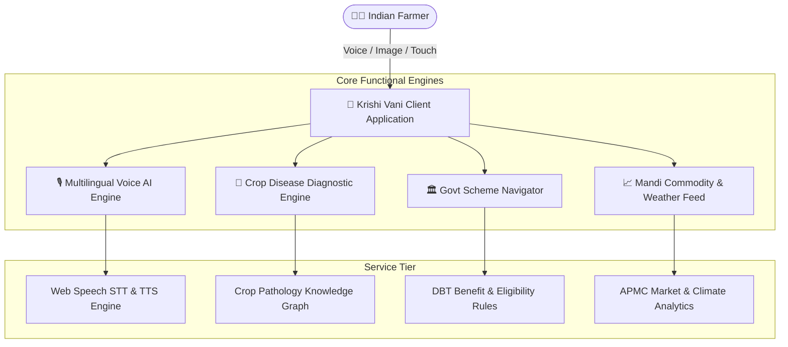

# 🌾 कृषि वाणी (Krishi Vani)
### AI Multilingual Farmer Voice Assistant & Scheme Navigator

[](./LICENSE)
[](https://react.dev/)
[](https://vitejs.dev/)
[](https://tailwindcss.com/)
[](https://mybharat.gov.in)
[](https://mybharat.gov.in)

---

## 📌 Executive Summary

**Krishi Vani** is a voice-first, AI-powered vernacular platform engineered for Indian farmers. It directly eliminates critical barriers in Indian agriculture: language and literacy exclusion, delayed crop disease intervention, lack of Direct Benefit Transfer (DBT) scheme awareness, and middleman price exploitation in APMC mandis.

Farmers converse naturally in their native mother tongue (**Hindi, Telugu, Tamil, Kannada, Marathi, English**), upload leaf photos for immediate AI crop disease diagnosis with organic and chemical remedies, verify eligibility for central/state welfare schemes, and monitor real-time mandi prices and weather advisories.

---

## 🏛️ Hackathon & Team Information

- **Event:** Hack for Social Cause (Viksit Bharat Young Leaders Dialogue 2027)
- **Knowledge Partner:** IIT Bombay & Ministry of Youth Affairs & Sports (MY Bharat)
- **Registration ID:** `HSC|TN|00193`
- **Team Name:** `vss`
- **Team Lead:** Sai Siddharth Vooka ([saisiddharthvooka@gmail.com](mailto:saisiddharthvooka@gmail.com))
- **Institution:** SRM Institute of Science and Technology, Chengalpattu, Tamil Nadu

---

## ✨ Key Features

1. **🎙️ Multilingual Voice AI Assistant:**
   - Hands-free, speech-to-speech interaction powered by Web Speech API.
   - Native support for Hindi, Telugu, Tamil, Kannada, Marathi, and English.
   - Text-to-speech audio playback enabling seamless access for semi-literate farmers.

2. **🌿 AI Crop Disease Diagnostics:**
   - Instant visual disease classification from leaf image uploads.
   - Detects Rice Blast, Tomato Early Blight, Maize Fall Armyworm, and more.
   - Dual-remedy approach: cost-effective organic treatments and precise chemical spray dosages.

3. **🏛️ Government Scheme Navigator:**
   - Central & State welfare scheme matcher (PM-KISAN, PMFBY, PM-KUSUM Solar Pump, Soil Health Card).
   - 30-second interactive eligibility quiz with document checklists.
   - Direct links to official DBT portals eliminating middleman agent commissions.

4. **📈 Live Mandi Rates & Agro-Weather Dashboard:**
   - Hourly APMC commodity prices across regional markets with trend indicators (`up`, `down`, `stable`).
   - Hyperlocal agro-weather tracking (temperature, humidity, wind, precipitation).
   - Actionable seasonal farming advisories for sowing, irrigation, and harvest.

---

## 📐 System Architecture



---

## 🛠️ Tech Stack

- **Framework:** [React 18](https://react.dev/) + [Vite 5](https://vitejs.dev/)
- **Styling:** [Tailwind CSS 3](https://tailwindcss.com/)
- **Icons:** [Lucide React](https://lucide.dev/)
- **Speech Engine:** Web Speech API (`SpeechRecognition` & `SpeechSynthesis`)
- **Language / Font System:** Plus Jakarta Sans & Unicode Indian Scripts

---

## ⚙️ Environment Variables

The project works out of the box with built-in offline mock data engines. For optional cloud services (Bhashini, OpenWeather, Agmarknet, Gemini Vision), configure your `.env` file:

1. Copy the template:
   ```bash
   cp .env.example .env
   ```
2. Available variables:
   ```env
   # Application Configuration
   VITE_APP_TITLE="Krishi Vani - AI Farmer Voice Assistant"
   VITE_APP_ENV="development"

   # Optional API Integrations (Fallback to local engine if omitted)
   VITE_BHASHINI_API_KEY=""
   VITE_WEATHER_API_KEY=""
   VITE_AGMARKNET_API_KEY=""
   VITE_GEMINI_API_KEY=""
   ```

---

## 🚀 Setup & Installation Steps

### Prerequisites
- **Node.js:** `v18.0.0` or higher (tested on `v24.14.0`)
- **NPM:** `v9.0.0` or higher (tested on `v11.9.0`)

### Step 1: Clone Repository
```bash
git clone https://github.com/siddharth-1118/krishi-vani.git
cd krishi-vani
```

### Step 2: Install Dependencies
```bash
npm install
```

### Step 3: Run Development Server
```bash
npm run dev
```
Open [http://localhost:5173](http://localhost:5173) in your browser.

### Step 4: Build for Production
```bash
npm run build
```
The optimized production bundle will be output to the `dist/` directory.

### Step 5: Preview Production Build
```bash
npm run preview
```

---

## 📁 Project Directory Structure

```text
krishi-vani/
├── .env.example               # Environment variables configuration template
├── .gitignore                 # Git ignore rules (node_modules, dist, logs)
├── index.html                 # HTML5 template with Google fonts
├── LICENSE                    # MIT License
├── package.json               # NPM dependencies and scripts
├── postcss.config.js          # PostCSS configuration for Tailwind
├── README.md                  # Complete project documentation
├── SUBMISSION_GUIDE.md        # MY Bharat hackathon pitch & submission guide
├── TECHNICAL_DESIGN.md        # Detailed Technical Design Document (TDD)
├── TEST_CASES.md              # Test suites, scenarios, and sample data
├── tailwind.config.js         # Custom emerald/krishi theme configuration
├── vite.config.js             # Vite build configuration
└── src/
    ├── App.jsx                # Main application component & layout
    ├── index.css              # Tailwind base & custom animations
    ├── main.jsx               # React DOM entrypoint
    ├── components/
    │   ├── DiseaseDiagnostic.jsx     # AI Crop leaf disease scanner & remedies
    │   ├── Header.jsx                # Branding & language selection header
    │   ├── MandiWeatherDashboard.jsx # APMC commodity rates & weather alert cards
    │   ├── SchemeNavigator.jsx       # Govt DBT scheme finder & eligibility quiz
    │   └── VoiceAssistant.jsx        # Multilingual STT & TTS voice assistant
    └── data/
        └── mockData.js               # Structured datasets for schemes, mandi, and remedies
```

---

## 🧪 Testing & Validation

All modules have verified test cases covering unit inputs, intent resolution, leaf diagnostics, and responsive layouts. Refer to [TEST_CASES.md](./TEST_CASES.md) for full test execution details.

To verify build integrity:
```bash
npm run build
```

---

## 📄 License

This project is licensed under the [MIT License](./LICENSE) — free to use, modify, and distribute.

---

**Developed with ❤️ for Viksit Gramin Bharat @2047 | Team vss (SRM Institute of Science and Technology)**
