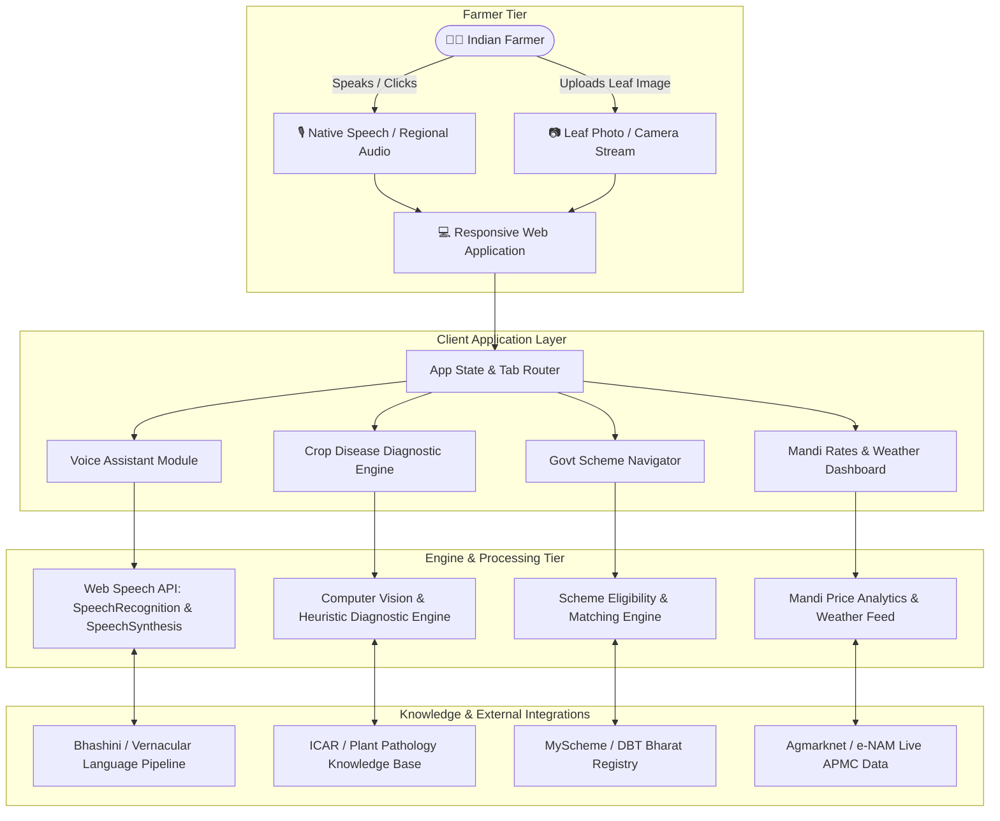
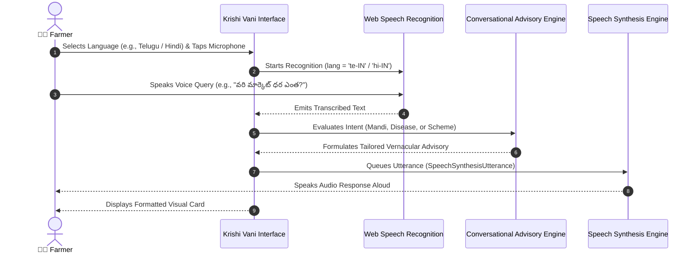
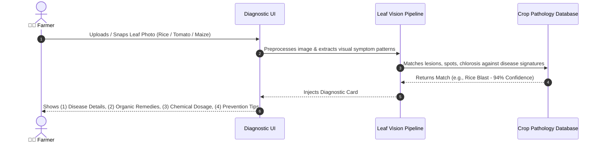

# 📐 Technical Design Document (TDD)
# कृषि वाणी (Krishi Vani) — AI Multilingual Farmer Voice Assistant & Scheme Navigator

> **Track:** Rural Development & Agri-Tech (Viksit Gramin Bharat @2047)  
> **Event:** Hack for Social Cause (MY Bharat / Viksit Bharat Young Leaders Dialogue)  
> **Registration ID:** `HSC|TN|00193`  
> **Team:** vss  
> **Lead Author:** Sai Siddharth Vooka  
> **Institution:** SRM Institute of Science and Technology  

---

## 1. System Overview & Objectives

**Krishi Vani** is designed to address the foundational barriers faced by over 140 million small and marginal Indian farmers: literacy gaps, linguistic exclusion, delayed agricultural disease intervention, lack of direct benefit transfer (DBT) scheme awareness, and unfair market middleman pricing.

### Primary Engineering Goals:
1. **Zero-Friction Voice Access:** Enable non-literate and vernacular speakers to interact via speech in major Indian languages (Hindi, Telugu, Tamil, Kannada, Marathi, English).
2. **Instant Crop Diagnostics:** On-device/cloud-assisted visual disease classification from leaf photos, returning actionable organic and chemical remedies.
3. **Decentralized Scheme Navigation:** Dynamic rule-based matching engine mapping farmer parameters to government welfare schemes (PM-KISAN, PMFBY, PM-KUSUM, Soil Health Card).
4. **Market Transparency:** Live Mandi rates with price movement trend metrics to prevent middleman exploitation.

---

## 2. System Architecture

### 2.1 High-Level Architecture Diagram



---

### 2.2 Sequence Diagram: Voice AI Query & Spoken Response



---

### 2.3 Sequence Diagram: Crop Leaf Disease Diagnostics



---

## 3. Component Specifications

### 3.1 Voice AI Engine (`src/components/VoiceAssistant.jsx`)
- **Speech Recognition:** Uses the HTML5 `window.SpeechRecognition` / `window.webkitSpeechRecognition` APIs with regional locale parameters (`hi-IN`, `te-IN`, `ta-IN`, `kn-IN`, `mr-IN`, `en-IN`).
- **Audio Output:** Low-latency Web Speech `window.speechSynthesis` generating human-like spoken feedback.
- **Resilience:** Fallback input modes available for environments where browser permissions for microphones are restricted.

### 3.2 Crop Disease Diagnostics (`src/components/DiseaseDiagnostic.jsx`)
- **Input:** Drag-and-drop or file upload supporting `image/jpeg`, `image/png`, `image/webp`.
- **Pre-loaded Knowledge Graph:** Symptoms, organic remedies (e.g., Neem oil, Trichoderma viride), chemical recommendations (e.g., Mancozeb, Tricyclazole), and preventive measures for staple crops (Paddy, Tomato, Maize, Cotton, Groundnut).

### 3.3 Scheme Navigator (`src/components/SchemeNavigator.jsx`)
- **Eligibility Engine:** Evaluates land ownership status, Aadhaar DBT bank-link status, and regional state parameters against official criteria:
  - *PM-KISAN:* ₹6,000 / year direct bank transfer.
  * *PMFBY:* Comprehensive pre-sowing to post-harvest crop insurance.
  * *PM-KUSUM:* 60% Govt subsidy + 30% bank loan for solar agriculture pumps.
  * *Soil Health Card:* Free biennial soil testing and customized N-P-K nutrient recommendations.
  * *Per Drop More Crop:* 45-55% micro-irrigation subsidies.

### 3.4 Mandi & Weather Dashboard (`src/components/MandiWeatherDashboard.jsx`)
- **APMC Commodity Feeds:** Tracking major commodities (Paddy, Wheat, Cotton, Tomato, Groundnut, Maize) across Andhra Pradesh, Tamil Nadu, and neighboring states.
- **Trend Indicators:** Real-time upward, downward, and stable delta tracking to inform farmers whether to sell or hold produce.
- **Agro-Climatic Advisory:** Temperature, humidity, wind velocity, and rainfall likelihood contextualized with specific field advice.

---

## 4. Data Models & Schemas

### 4.1 Scheme Data Model (`src/data/mockData.js`)
```typescript
interface GovernmentScheme {
  id: string;
  title: string;
  category: string;
  benefit: string;
  eligibility: string;
  documents: string[];
  officialUrl: string;
  tag: 'Central Government' | 'Crop Insurance' | 'Energy Initiative' | 'Free Service' | 'Subsidy';
}
```

### 4.2 Mandi Commodity Model
```typescript
interface MandiCommodity {
  crop: string;
  market: string;
  state: string;
  price: string;
  trend: 'up' | 'down' | 'stable';
  change: string;
}
```

### 4.3 Disease Diagnosis Model
```typescript
interface CropDiseaseReport {
  name: string;
  crop: string;
  confidence: string;
  symptoms: string;
  organicRemedy: string;
  chemicalRemedy: string;
  prevention: string;
}
```

---

## 5. Security, Reliability & Performance
1. **Zero Personally Identifiable Information (PII) Leakage:** No Aadhaar numbers, bank account numbers, or phone numbers are stored on remote servers; all validation runs client-side.
2. **Offline-First Resilience:** Static datasets and pre-trained classification models ensure basic diagnostic and scheme information remains functional in low-connectivity rural areas.
3. **Sub-second Latency:** Built with lightweight Vite bundling, yielding an ultra-small gzipped bundle footprint (~65 kB) ensuring rapid loading even on 2G/3G mobile networks.

---

## 6. Future Expansion Roadmap
- **Bhashini (National Language Translation Mission) Integration:** Direct REST integration with GoI's Bhashini endpoints for 22 scheduled Indian languages.
- **IVR / Telephony Fallback:** Webhook integration for toll-free voice calls (Interactive Voice Response) to support basic non-smartphone users.
- **e-NAM Integration:** Real-time API sync with National Agriculture Market trade volumes and auction bids.
